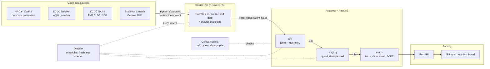

# SmokeWatch Canada

[](https://github.com/omarfaruqe/smokewatch-canada/actions/workflows/ci.yml)

A national data engineering platform that tracks wildfires, smoke and air quality across all
Canadian provinces and territories, and estimates daily population exposure to poor air.

**[Version française](README.fr.md)**

## Data sources

| Source | Publisher | Content | Cadence |
|---|---|---|---|
| CWFIS hotspots (WFS) | Natural Resources Canada | Satellite-detected fire hotspots | Daily |
| CWFIS fire perimeters | Natural Resources Canada | Current fire perimeters, snapshotted daily for SCD2 history | Daily |
| MSC GeoMet / Datamart | Environment and Climate Change Canada | AQHI observations and forecasts, weather | Hourly |
| NAPS archive | Environment and Climate Change Canada | Hourly PM2.5, O3, NO2 by station (historical AQHI computed from these) | Yearly |
| CWFIS perimeter archive | Natural Resources Canada | Final fire perimeters of past seasons | Yearly |
| Census 2021 | Statistics Canada | Census division and province boundaries, population (table 98-10-0007-01) | Static |

## Architecture



## Quick start

```bash
cp .env.example .env            # then edit the passwords
docker compose up -d            # Postgres+PostGIS on :5433, SeaweedFS S3 on :8333 (filer UI :8888)
uv venv --python 3.13 .venv && source .venv/bin/activate   # dagster-dbt needs Python < 3.14
uv pip install -e ".[dev,dbt,orchestration]"
pytest -q                       # offline tests
smokewatch hotspots --sink s3   # last 24 h of hotspots -> bronze
smokewatch hotspots --start 2023-06-01 --end 2023-06-07 --sink s3   # backfill
smokewatch aqhi observations --sink s3   # today's hourly AQHI
smokewatch aqhi forecasts --sink s3      # merge current forecast window
smokewatch weather --sink s3             # yesterday's hourly weather, all stations
smokewatch statcan --sink s3             # 2021 Census boundaries + population (once)
smokewatch perimeters --sink s3          # daily fire perimeter snapshot
smokewatch load census                   # bronze -> PostGIS raw schema (once)
smokewatch load features                 # bronze -> raw, only changed partitions
set -a && source .env && set +a && dbt build --project-dir transform --profiles-dir transform
```

## 2023 season backfill

```bash
smokewatch hotspots --sink s3 --start 2023-05-01 --end 2023-09-30   # 3.29 M detections
smokewatch weather  --sink s3 --start 2023-05-01 --end 2023-09-30   # 3.27 M hourly records
smokewatch naps --year 2023 --sink s3                               # PM2.5, O3, NO2 + stations
smokewatch perimeters --season 2023 --sink s3                       # 1,144 final perimeters
smokewatch load features && smokewatch load naps && smokewatch load season-perimeters
```

Validated against known events: computed AQHI of 15-17 in Montreal on 2023-06-25, Quebec's
hotspot peak in June, the Northwest Territories' in August, and 16.0 M ha of season perimeters
nationally. See `docs/sources/` for each source's profile and caveats.

## API and dashboard

```bash
uv pip install -e ".[api]"
uvicorn smokewatch.api.main:app --port 8000
```

- **Dashboard:** http://localhost:8000/ — bilingual (EN/FR) map of census divisions coloured by
  daily peak AQHI (official AQHI scale), satellite hotspots and 2023 final fire perimeters,
  with a season replay and an exposure chart
- **API docs:** http://localhost:8000/docs

| Endpoint | Returns |
|---|---|
| `GET /health` | Status and data coverage |
| `GET /exposure/daily?start=&end=` | National daily totals: population exposed, hotspots, peak AQHI |
| `GET /exposure?date=&province=` | Census divisions for a day, most exposed first |
| `GET /geo/census-divisions?date=` | GeoJSON census divisions with the day's metrics |
| `GET /geo/hotspots?date=&province=&limit=` | GeoJSON hotspots (strongest first) |
| `GET /geo/fires/season/{year}` | GeoJSON final season perimeters |
| `GET /fires/{id}/history` | SCD2 growth history of a current fire |
| `GET /aqhi?date=&cduid=` | Hourly AQHI for a census division |

### Peak exposure days, 2023

| Day | People in divisions with high-risk air | Peak AQHI |
|---|---|---|
| 2023-06-30 | 15.4 M | 12.0 |
| 2023-06-06 | 12.6 M | 14.3 |
| 2023-07-01 | 12.6 M | 16.0 |
| 2023-06-07 | 10.6 M | 30.6 |

Upper bounds: a division's whole population counts once any of its AQHI locations reaches
high risk (rounded AQHI 7+) that UTC day.

## Orchestration (Dagster)

```bash
export DAGSTER_HOME="$PWD/.dagster" && dagster dev   # UI at http://localhost:3000
```

| Schedule (America/Toronto) | Job | What runs |
|---|---|---|
| Every hour at :20 | `hourly_air_quality` | AQHI observations and forecasts, their raw loads and downstream dbt models |
| Daily at 07:35 | `daily_pipeline` | Hotspots, fire perimeters, weather, AQHI re-pull, all raw loads, full dbt build |

- Extraction and load assets retry 3 times with exponential backoff
- Each raw table has a `partition_freshness` check (warns when the newest partition is too old)
- dbt tests run with the models and appear as asset checks
- StatCan census assets are one-time loads and are not scheduled

## Data quality

- **Load:** sha256 manifests per bronze partition; unchanged partitions are skipped
- **dbt tests:** keys, accepted values, relationships, geometry validity, population
  reconciliation (census divisions sum to the Canada total), SCD2 interval integrity, and a
  warning if fewer than 95% of hotspots carry an agency code matching their province
- **Freshness:** Dagster asset checks on every raw table

## Roadmap

- [x] Sprint 1 — Repo setup, local stack, CWFIS hotspot extractor to bronze
- [x] Sprint 2 — AQHI and weather ingestion
- [x] Sprint 3 — Census boundaries and population in PostGIS
- [x] Sprint 4 — dbt models, spatial joins, SCD2 fire tracking
- [x] Sprint 5 — Orchestration and data quality
- [x] Sprint 6 — Historical backfill (2023 season)
- [x] Sprint 7 — API and map dashboard
- [ ] Sprint 8 — CI/CD, docs, bilingual README

## Licence and data attribution

Code: MIT. Data: contains information licensed under the
[Open Government Licence – Canada](https://open.canada.ca/en/open-government-licence-canada).
